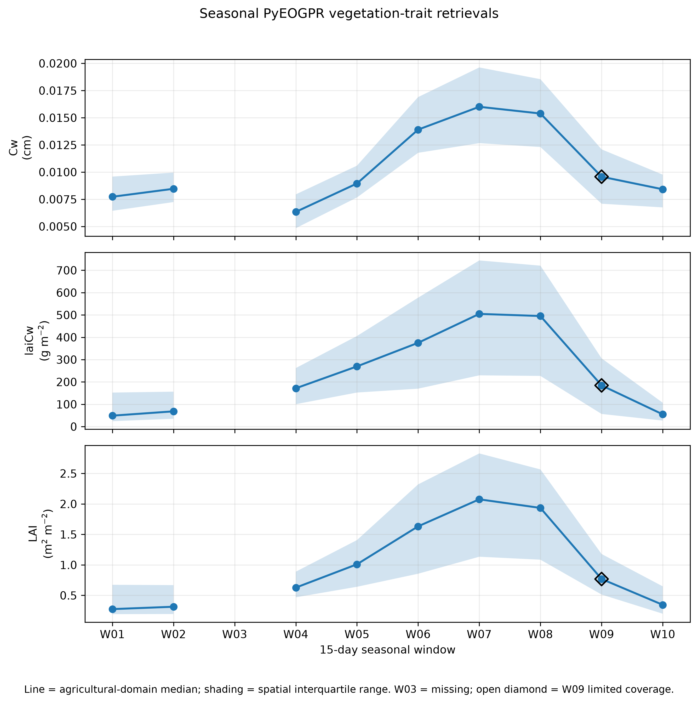
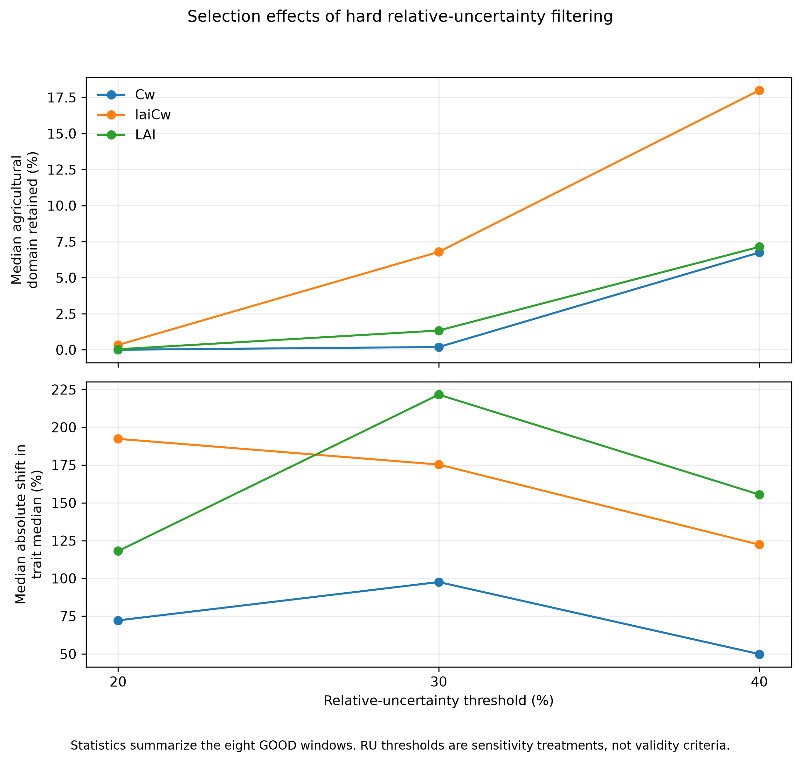
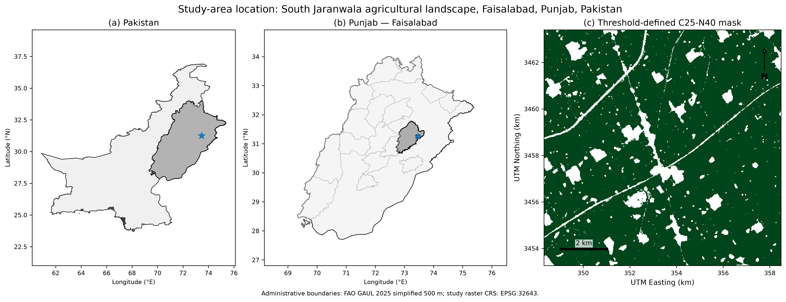

# Uncertainty-Aware Retrieval of Vegetation Water Traits from Sentinel-2 for Irrigated Cropland Monitoring in Punjab, Pakistan

**Author: Mohsin Ahmad · Research project · Final evidence archive**

How closely do uncertainty-aware PyEOGPR vegetation water-related traits follow seasonal cropland dynamics, and how do they correspond with conventional Sentinel-2 indices and broad hydroclimatic context?

This case study examines South Jaranwala / Buchiana, Faisalabad District, Pakistan. It combines satellite trait retrievals, explicit observation coverage, and uncertainty sensitivity analysis. It does not establish field-validated crop water stress, irrigation deficit or drought stress.

[Scientific report](docs/final_report.md) · [Executive summary](docs/project_summary.md) · [Portfolio materials](docs/portfolio_summary.md) · [Captions](docs/captions.md) · [Reproduction guide](docs/reproducibility.md)

## Study and data

Bounding box: 73.408–73.513° E, 31.205–31.295° N; center 31.250° N, 73.4605° E. Nominal study season: 15 November 2025–15 April 2026. The ten fixed 15-day production windows terminate on 14 April (exclusive), leaving the final one-day remainder unanalyzed. Outputs use a 20 m grid in EPSG:32643.

| Source | Role |
|---|---|
| Sentinel-2 harmonized L1C / PyEOGPR | Cw (cm), laiCw (g m⁻²), LAI (m² m⁻²), native absolute GPR uncertainty |
| Sentinel-2 | NDVI and NDMI comparison indices |
| Dynamic World and seasonal maximum NDVI | Threshold-defined agricultural mask |
| CHIRPS | Concurrent and antecedent rainfall context |
| ERA5-Land | Upper-soil-water proxy and 2-m temperature context |

Dataset identifiers and verified source references are in the report. Indices share Sentinel-2 information with the retrievals; their agreement is not independent validation.

## Workflow and frozen decisions

1. Filter scenes using `CLOUDY_PIXEL_PERCENTAGE < 80`, mask QA60 bits 10 and 11, and compute mean-reflectance composites.
2. Apply pretrained PyEOGPR models and retain their native absolute uncertainty. No spatial or temporal gap filling is used.
3. Construct C25-N40: crop frequency ≥0.25, seasonal maximum NDVI ≥0.40, built-up frequency <0.20, water frequency <0.20. The corrected v2 driver export restores projection and aggregates 10 m inputs to 20 m.
4. Summarize traits and indices on common valid agricultural support; compare spatial and temporal correspondence.
5. Assess mask thresholds, stable spatial support and relative-uncertainty filtering; add hydroclimate as context.

The primary analysis uses **223,600 retrieval-supported agricultural pixels (89.44 km²), representing 97.33% of the 91.89 km² threshold-defined C25-N40 agricultural mask** (229,729 pixels). These domains are different.

Eight GOOD windows are W01, W02, W04, W05, W06, W07, W08 and W10. W03 is MISSING. W09 is LIMITED: 55.0215% of the stable core, retained descriptively and excluded from primary temporal correlations. Table 1 expresses coverage against the larger threshold mask, hence its W09 value is 53.55%.

## Uncertainty and main results

Native absolute GPR uncertainty is a continuous model output in trait units. Spatial IQR describes spatial variation, not uncertainty in the seasonal median. RU = native uncertainty / predicted trait magnitude; <20%, <30% and <40% were sensitivity treatments only. No universal hard RU filter is applied.

| Locked result | Value |
|---|---:|
| laiCw–NDVI temporal Pearson r | 0.9833 |
| laiCw–NDMI temporal Pearson r | 0.9617 |
| LAI–NDVI temporal Pearson r | 0.9861 |
| Cw–NDMI spatial Pearson r across GOOD windows | 0.2810–0.8646 |
| Maximum mask-threshold trajectory normalized MAD | 0.3870% |
| Maximum stable-support trajectory normalized MAD | ≈0.000002% |
| Largest RU-induced absolute median shift: laiCw, RU <20% | 1427.70% |

All temporal correlations use eight GOOD windows. These are descriptive associations. Hard RU filtering produced severe magnitude-dependent selection effects. Hydroclimatic associations are strongly confounded by seasonal crop development; ERA5-Land does not measure canal irrigation.

## Key figures







Figures 7 and 10 display the larger threshold mask, not the 89.44 km² retrieval footprint. Full captions and the ten-figure index are in [docs/captions.md](docs/captions.md).

## Software and reproduction

PyEOGPR upstream commit: `7c470644f33cc08ca934e0e44f3808b17aaf07f5`. Three local changes update the model-download URL with HTTP checks, use mean Sentinel-2 compositing, and make the scene-cloud threshold configurable. No GPR coefficients, equations, bands or pretrained parameters changed. See [software notes](docs/software_notes.md) and [patch](docs/pyeogpr_local_patch.diff).

Observed environment: Python 3.14.6; direct dependencies pinned in `requirements.txt`. See the [setup and command sequence](docs/reproducibility.md), including Earth Engine authentication and manual export/download steps. For a local evidence check:

```powershell
.venv/Scripts/python.exe scripts/verify_finalization.py
```

## Repository layout

```text
src/                        preserved numbered scientific scripts
scripts/                    read-only finalization verification
config/                     frozen study settings and public-safe example
external/README.md          pinned dependency instructions
figures/{final_core,spatial_final,locator}/
outputs/final_evidence/step20a/  six final tables, register, original audit
outputs/analysis/           supporting numerical CSVs
outputs/hydroclimate/       contextual CSVs
docs/                       report, captions, portfolio, provenance
requirements.txt            observed direct dependency versions
```

Large rasters, local credentials/configuration, environments, CV files, caches, historical figures and the upstream checkout are excluded from Git. They remain locally preserved.

## Limitations, citation and author

One landscape and one season, eight usable temporal samples, cloud-related missingness, a threshold-defined mask, shared Sentinel-2 inputs, and coarse contextual climate data constrain interpretation. Native uncertainty has not been calibrated against field observations here. Small changes under the tested masks do not establish crop-map accuracy. The repository omits raster inputs, so a fresh clone alone cannot regenerate every pixel-level result.

Suggested project citation: Ahmad, M. (2026). *Uncertainty-Aware Retrieval of Vegetation Water Traits from Sentinel-2 for Irrigated Cropland Monitoring in Punjab, Pakistan*. Research project; cite the repository commit used. No publication acceptance or DOI is claimed. Also cite Kovács, De Clerck and Verrelst (2025), [PyEOGPR](https://doi.org/10.1016/j.ecoinf.2025.103497), and the dataset sources listed in the report.

Mohsin Ahmad — project analysis and research documentation. PyEOGPR and source datasets are credited to their original developers and providers. The existing repository license is retained; third-party components retain their respective terms.
